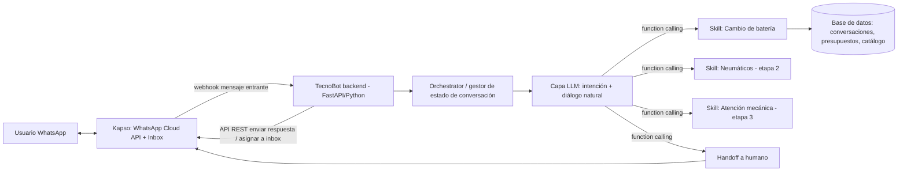
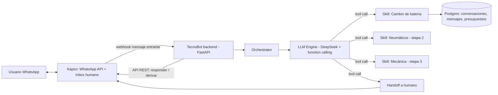

# WhatsApp bot app structure

_Conversación reconstruida a partir del export de Cursor (solo mensajes de usuario y assistant)._


## 🧑 Usuario _(Thursday, Jul 9, 2026, 12:06 PM (UTC-3))_

quiero desarrollar una app bot de whatsapp. El proyecto se llama TecnoBot, es el bot de la empresa tecnocar

El bot tiene como objetivo recibir una consulta, entender si aplica a alguna de las soluciones posibles, derivar a un motor que genere presupuesto (si aplica a alguna de ellas) o a una persona si solicita hablar con un agente o si no puede resolver.

Por el momento solo aplicable a:

1) cambio de bateria => presupuesto de cambio 

Ayudame a encontrar la estructura de mi app, la idea es que despues escale considerando (en etapas del proyecto):

2) presupuestado de compra y colocacion de neumaticos

3) presupuestado de atencion mecanica

------------

Necesito que me ayudes a pensar la estructura de la app para desarrollarla desde cero. Soy desarrollador python y conozco algo de java y C#. 

Escuché que https://kapso.com/ puede ser util para mi caso, evaluar si es asi.

Considerar que el proyecto no escalará a mas de esos 3 puntos, con lo cual no tiene que ser algo complejo.

Si tiene que cumplir que el usuario sienta que esta hablando con una persona, es decir el bot debe ser inteligente


## 🤖 Assistant

No hay todavía un proyecto creado, así que arranco desde cero con una propuesta de arquitectura.

## 1. Evaluación de Kapso para tu caso

Kapso es una plataforma que actúa como capa intermedia sobre la **API oficial de WhatsApp Cloud (Meta)**. No es un "motor de IA" en sí mismo, sino infraestructura de mensajería + algunas piezas de orquestación:

**Lo que te resuelve:**
- Setup rápido (sandbox en minutos, sin pasar por toda la verificación de negocio de Meta al principio).
- Webhooks normalizados (mensajes entrantes, estados de entrega, botones/listas, WhatsApp Flows).
- **Inbox + handoff a humanos** ya construido: esto es justo una de tus piezas clave (derivar a una persona), y te ahorra construir una UI de atención para tus agentes.
- CLI, MCP y un "Workflow builder" visual para armar flujos simples con nodos de IA, sin código.

**Lo que hay que tener en cuenta:**
- Su SDK "rico" (`@kapso/chat-adapter`) y las *serverless functions* son **JavaScript/TypeScript**, no Python. Como vos programás en Python, esa parte del ecosistema no te sirve directamente.
- Sin embargo, el core es **REST API + webhooks**, agnóstico de lenguaje. Podés perfectamente tener tu backend en **FastAPI (Python)** recibiendo los webhooks de Kapso y llamando a su API con `requests`/`httpx` para responder. No necesitás su SDK ni sus funciones JS.
- Es un servicio de pago (por mensaje, con tiers), y agrega un vendor más a tu stack. Meta te cobra las conversaciones aparte.
- Alternativa "directa": pegarle a la **API de WhatsApp Cloud de Meta** sin intermediarios (gratis salvo las tarifas de Meta), usando alguna librería Python (`heyoo`, `whatsapp-python`, o simplemente `requests`). Es más barato y sin vendor lock-in, pero vos mismo tenés que manejar verificación de negocio, tokens, webhooks firmados, inbox para el humano, etc.

**Mi recomendación:** dado que tu proyecto es chico (3 flujos, no va a escalar más) pero necesitás sí o sí el handoff a un humano con una interfaz decente, **Kapso tiene sentido para arrancar rápido**, especialmente en la fase de desarrollo/pruebas (sandbox gratuito, sin pelear con Meta Business Verification desde el día 1). La clave es que tu "cerebro" (la inteligencia del bot, el motor de presupuestos) **no viva dentro de Kapso**, sino en tu propio servicio Python — así si en el futuro querés migrar a Meta directo, a Twilio, o a cualquier otro proveedor, solo cambiás la capa de "canal" y no tocás la lógica de negocio.

## 2. Arquitectura general



Separás en 4 responsabilidades claras:

1. **Canal (Kapso/WhatsApp):** entrada/salida de mensajes, botones, inbox para humanos.
2. **Orchestrator:** mantiene el estado de la conversación (qué se preguntó, qué falta, si ya se derivó a un humano).
3. **Capa de inteligencia (LLM):** decide intención, conversa de forma natural, y cuando corresponde invoca una "tool" (function calling) para ejecutar lógica determinística.
4. **Skills (motores de presupuesto):** módulos de negocio, uno por servicio, con una interfaz común para que agregar el punto 2 y 3 sea "plug-in", no una reescritura.

## 3. Por qué usar un LLM con function calling (para que "se sienta una persona")

Un bot de árbol de decisiones ("si dice 1, mostrame menú...") no se siente humano y es frágil ante lenguaje libre. La forma estándar hoy de lograr eso sin volverlo complejo es:

- Usar un LLM (OpenAI GPT-4o-mini, Claude Haiku, etc. — baratos y rápidos) como "cerebro conversacional", con un **system prompt** que define la personalidad de TecnoBot, el tono, y **qué puede y no puede hacer**.
- Definirle **tools/functions** que el modelo puede invocar cuando detecta que aplican, por ejemplo:
  - `iniciar_presupuesto_bateria(marca, modelo, anio)` 
  - `derivar_a_humano(motivo)`
  - `consultar_estado_presupuesto(id)`
- El LLM se encarga de la charla natural (saludos, aclarar dudas, pedir los datos faltantes en lenguaje natural) y tu código Python se encarga de lo determinístico (calcular precio, guardar en DB, notificar al humano). Esto evita "alucinaciones" en la parte crítica (el precio nunca lo inventa el modelo, lo calcula tu función).
- Regla de fallback: si el LLM no logra mapear el pedido a ninguna tool tras N intentos, o el usuario pide explícitamente hablar con alguien, se llama a `derivar_a_humano`.

Esto es liviano: no necesitás LangChain/LangGraph ni un framework de agentes pesado para 3 flujos. Alcanza con el SDK oficial de OpenAI/Anthropic usando function calling directo.

## 4. Estructura de carpetas propuesta (Python)

```text
tecnobot/
├── app/
│   ├── main.py                    # FastAPI app + endpoint /webhooks/kapso
│   ├── config.py                  # settings vía pydantic-settings (.env)
│   │
│   ├── channel/                   # todo lo que sabe de "Kapso/WhatsApp"
│   │   ├── kapso_client.py        # wrapper HTTP: enviar texto/botones, asignar a inbox
│   │   └── schemas.py             # modelos Pydantic del payload del webhook
│   │
│   ├── conversation/
│   │   ├── orchestrator.py        # recibe mensaje -> carga estado -> llama al LLM -> responde
│   │   ├── state_store.py         # persistencia del estado de conversación (Postgres)
│   │   └── llm_engine.py          # llamada al LLM con function calling + historial
│   │
│   ├── skills/                    # <-- acá escala el proyecto en etapas
│   │   ├── base.py                # clase abstracta Skill (nombre, slots requeridos, calcular())
│   │   ├── battery_change.py      # Etapa 1: implementado ahora
│   │   ├── tires.py                # Etapa 2: placeholder a futuro
│   │   └── mechanical_service.py  # Etapa 3: placeholder a futuro
│   │
│   ├── handoff/
│   │   └── human_handoff.py       # marca conversación como "derivada", notifica al equipo
│   │
│   ├── models/                    # SQLModel/SQLAlchemy: Conversation, Message, Quote, Customer
│   ├── db/
│   │   ├── session.py
│   │   └── migrations/            # Alembic
│   │
│   └── prompts/
│       └── system_prompt.md       # personalidad y reglas de TecnoBot
│
├── tests/
├── .env.example
├── pyproject.toml
├── Dockerfile
├── docker-compose.yml             # app + postgres
└── README.md
```

### El patrón clave para escalar: `Skill`

```python
# app/skills/base.py
from abc import ABC, abstractmethod

class Skill(ABC):
    name: str                     # ej: "cambio_bateria"
    description: str              # usada para que el LLM sepa cuándo invocarla
    required_slots: list[str]     # ej: ["marca", "modelo", "anio"]

    @abstractmethod
    def calculate_quote(self, slots: dict) -> dict:
        """Devuelve precio/rango y detalle del presupuesto."""
        ...
```

Cada etapa nueva (neumáticos, mecánica) es solo: crear un archivo en `skills/`, implementar `calculate_quote`, y registrarlo en una lista que se expone al LLM como tools disponibles. El `orchestrator` y el `llm_engine` no cambian.

## 5. Stack recomendado

| Capa | Recomendación | Por qué |
|---|---|---|
| Backend | **FastAPI** | Async, ideal para webhooks, tipado con Pydantic |
| LLM | OpenAI (`gpt-4o-mini`) o Anthropic (Haiku) vía SDK oficial + function calling | Barato, rápido, sin frameworks pesados para 3 flujos |
| DB | **PostgreSQL** + SQLModel/SQLAlchemy | Conversaciones, presupuestos, catálogo de precios |
| Canal WhatsApp | **Kapso** (para arrancar) | Setup rápido + inbox/handoff ya resuelto |
| Deploy | Railway / Fly.io / Render, o VPS + Docker | Bajo volumen, no necesitás Kubernetes |
| Motor de presupuesto (etapa 1) | Tabla de precios en DB o YAML (marca/modelo/tipo batería) | Simple, fácil de mantener sin código |

No necesitás Redis ni colas (Celery) a esta escala; el estado de conversación puede vivir directamente en Postgres.

## 6. Flujo de una conversación (ejemplo cambio de batería)

1. Usuario escribe "hola, se me murió la batería del auto".
2. Kapso manda webhook → tu `main.py` → `orchestrator.handle_message(...)`.
3. Orchestrator carga (o crea) el estado de la conversación desde la DB.
4. Le pasa el mensaje + historial al `llm_engine`, junto con las tools disponibles (`iniciar_presupuesto_bateria`, `iniciar_presupuesto_neumaticos` (a futuro), `derivar_a_humano`).
5. El LLM entiende la intención, y si faltan datos (marca/modelo/año del auto), los pide de forma conversacional, uno o varios a la vez.
6. Cuando están completos los `slots`, se invoca `battery_change.calculate_quote(slots)` → devuelve precio.
7. El LLM redacta la respuesta final al usuario con el presupuesto.
8. Si el usuario dice "quiero hablar con alguien" o el LLM no puede resolverlo → `human_handoff` marca la conversación, notifica al equipo (vía el inbox de Kapso) y el bot deja de responder automáticamente en ese hilo.

## 7. Próximos pasos concretos

Te sugiero, en orden:
1. Crear cuenta sandbox en Kapso y mandar/recibir un mensaje de prueba con `curl`/Postman para entender bien el webhook y la API.
2. Armar el esqueleto FastAPI con el endpoint de webhook y un "echo bot" (sin LLM todavía) para validar la conexión de punta a punta.
3. Sumar la capa LLM con una sola tool dummy, validar function calling.
4. Implementar el skill real de `battery_change` con una tabla de precios simple.
5. Implementar `human_handoff` usando el inbox de Kapso.
6. Recién ahí, iterar sobre el prompt/tono para que la conversación se sienta natural (esto se afina mucho con pruebas reales).

¿Querés que profundice en alguna parte —por ejemplo el diseño del `system_prompt`, el modelo de datos de la conversación, o cómo estructurar la tabla de precios de baterías— antes de pasar a Agent mode para empezar a codear?


## 🧑 Usuario _(Thursday, Jul 9, 2026, 12:40 PM (UTC-3))_

Me encanta la "Arquitectura general" propuesta en el punto 2. Vamos con esa.

Sin embargo resolveme las siguientes dudas antes de avanzar:
* que es un SDK. que es el SDK de kapso
* he codeado en typescript, no seria algo nuevo para mi. no descartaría el uso de una buena herramienta por ese factor. Lo que si, la app tiene que estar en su mayoría en Python, ya que me siento mas cómodo.
* Dicho esto, y suponiendo que seguimos la "Arquitectura general" actual. ¿Conviene utilizar kapso solo para "Canal entrada/salida de mensajes, botones, inbox para humanos"? no hay una herramienta open source/gratuita aplicable a Python?
* cuales son los valores de kapso y si tiene una versión de trial para la funcionalidad que tenemos planeado asignarle


## 🤖 Assistant

Vamos por partes.

## 1) ¿Qué es un SDK? ¿Qué es el SDK de Kapso?

Un **SDK (Software Development Kit)** es un paquete de herramientas que un proveedor te da para integrarte con su servicio más fácil, en lugar de que hagas los llamados HTTP "a mano". Normalmente incluye: una librería de código (funciones/clases ya armadas), tipado, manejo de autenticación, y a veces utilidades extra (CLI, emuladores, etc.). La alternativa a usar un SDK siempre es golpear la **API REST directamente** con `requests`/`httpx` — más manual, pero funciona igual y es 100% agnóstico de lenguaje.

El "SDK" de Kapso en realidad son varias cosas separadas, todas en el ecosistema **Node/TypeScript**:

- `@kapso/chat-adapter`: conecta Kapso con frameworks de chat tipo "Chat SDK" (de Vercel), pensado para apps Next.js/Node.
- `@kapso/whatsapp-cloud-api`: wrapper de más bajo nivel sobre la API de WhatsApp (templates, flows, catálogos), también TS/JS.
- Un **CLI** (`kapso` en terminal, ese sí es agnóstico, es un binario).
- Un **servidor MCP** (para que agentes de IA operen WhatsApp por su cuenta, más pensado para uso en herramientas como Cursor/Claude que para tu backend de producción).

Ninguna de estas piezas está en Python. Pero **no las necesitás**: por debajo de todo eso, Kapso es una API REST + webhooks JSON estándar. Podés consumirla perfectamente desde FastAPI con `httpx`, sin ningún SDK — es lo que te recomendé desde el principio.

## 2) Sobre TypeScript

Que sepas TypeScript te da una opción más si en algún momento quisieras aprovechar piezas específicas de Kapso que son JS-only, como las *serverless functions* (para lógica dentro de sus Workflows) o su *chat-adapter*. Pero dado que ya decidiste que la app va a ser **mayormente Python**, mi recomendación es: **ignorá el SDK y las serverless functions de Kapso por completo**, y hablále solo por REST/webhooks desde tu backend Python. Meter un segundo lenguaje (funciones JS sueltas dentro de Kapso) para un proyecto de este tamaño solo te suma superficie de mantenimiento sin necesidad real — toda tu inteligencia (LLM + skills) puede y debe vivir en tu FastAPI.

## 3) ¿Hay una alternativa open source / gratuita en Python para el "canal"?

Sí. Acá tenés tres caminos, de menor a mayor trabajo propio:

### Opción A — Chatwoot (self-hosted, open source) ⭐ mi recomendación si querés evitar vendor lock-in

[Chatwoot](https://www.chatwoot.com/) es una plataforma de atención al cliente open source (tipo Zendesk/Intercom), self-hosted, que **ya tiene soporte nativo para WhatsApp Cloud API** y un concepto llamado **Agent Bot** que calza casi perfecto con lo que necesitás:

- Cada conversación nueva entra con estado `pending` (tu bot la maneja).
- Tu bot recibe webhooks de Chatwoot por cada mensaje entrante, responde vía su API.
- Cuando el bot decide derivar a un humano, simplemente hace un `PATCH` cambiando el estado de la conversación a `open` → aparece en la bandeja de un agente humano real, con toda la UI de inbox ya construida (sin que vos tengas que programar nada de eso).
- El agente puede devolver la conversación al bot cambiando el estado de nuevo a `pending`.

Es decir, resuelve exactamente tu pieza de "canal + botones + inbox para humanos", gratis (Community Edition), y lo consumís 100% vía REST/webhooks desde Python — Chatwoot está hecho en Ruby on Rails, pero eso no importa porque nunca tocás su código, solo su API.

**Contras a tener en cuenta:**
- Es **self-hosted**: tenés que correrlo vos (Docker Compose incluido en su repo), lo que suma una pieza más de infraestructura para mantener (DB propia, actualizaciones, backups).
- Igual necesitás pasar por la configuración de Meta (verificación de negocio, número, token de acceso) — Chatwoot no te la simplifica como el "sandbox en 2 minutos" de Kapso. Tenés que tener HTTPS público para el webhook desde el día 1.
- Es una herramienta pensada para *soporte omnicanal* en general (mucho más grande que lo que necesitás); vas a usar una fracción chica de sus features.

### Opción B — Meta WhatsApp Cloud API directo, sin intermediarios

Pegarle directo a la API de Meta con Python (`httpx`/`requests`, o wrappers finitos como `heyoo`). Es gratis (solo pagás las tarifas de conversación de Meta), sin vendor de por medio. El costo es que **vos construís todo lo que Kapso/Chatwoot te dan gratis**: manejo de tokens, verificación de webhook, y sobre todo **la interfaz para que el humano responda** (algo tan simple como una página con lista de conversaciones + botón "responder" que llame a tu propia función de envío). Para 3 flujos y un volumen bajo, esto es totalmente viable en un par de días de trabajo, pero es trabajo real que no es el objetivo del proyecto.

### Opción C — Kapso (gestionado, no OSS pero con free tier generoso)

Ya la vimos: cero infraestructura propia, setup en minutos, inbox+handoff incluido. El costo es que es un servicio de terceros (aunque no tenés que usar su SDK/JS).

**Mi sugerencia honesta:** si tu prioridad es "gratis y open source" y no te molesta un poco de DevOps, **Chatwoot** es la opción que más se parece a "Kapso pero libre". Si tu prioridad es "cero fricción, empezar a codear la lógica del bot ya", **Kapso Free** te lo da sin que toques infraestructura. Ambas te permiten mantener el resto de la arquitectura (Orchestrator, LLM, Skills) idéntica — es solo la capa de canal la que cambia, así que incluso podrías prototipar con Kapso Free ahora y migrar a Chatwoot después si el proyecto crece, sin rehacer nada del "cerebro".

## 4) Valores de Kapso y trial

No es un "trial" en el sentido de tiempo limitado — es un **plan Free permanente**, sin tarjeta de crédito:

| Plan | Precio | Mensajes/mes | Números conectados | Storage media | Function calls |
|---|---|---|---|---|---|
| **Free** | $0 | 2.000 | 1 (+ sandbox) | 1 GB | — |
| **Pro** | $25/mes | 100.000 | 3 (+$10 c/extra) | 100 GB | 1.000.000 |
| **Platform** | $299/mes | 1.000.000 | 50 (+$5 c/extra) | 1 TB | 10.000.000 |
| **Enterprise** | A medida | — | — | — | — |

Todos los planes (incluido Free) incluyen: llamadas API ilimitadas, "AI agents"/Workflows ilimitados, y el número sandbox. La diferencia entre planes es volumen de mensajes, números y storage.

**Para tu caso (etapa 1, solo cambio de batería, presumiblemente bajo volumen al arrancar):** el plan **Free (2.000 mensajes/mes, 1 número)** te alcanza cómodamente para desarrollo, pruebas, e incluso una primera puesta en producción de bajo tráfico — sin gastar nada. Recién si Tecnocar escala en volumen real de conversaciones vas a necesitar mirar el Pro ($25/mes).

---

¿Con esto te queda claro para decidir entre Kapso vs Chatwoot vs Meta directo? Si querés, puedo armar una comparación más al detalle de "esfuerzo de setup inicial" entre las tres para que definas antes de que pasemos a diseñar el resto (orchestrator, LLM, modelo de datos).


## 🧑 Usuario _(Thursday, Jul 9, 2026, 12:54 PM (UTC-3))_

Perfecta tu recomendacion e informacion. Ahora si. Hagamos un plan para prototipar con Kapso Free ahora y quizas si el proyecto lo requiere, migrar a Chatwoot después (si el proyecto crece), sin rehacer nada del "cerebro".
Como serian los pasos para armar este proyecto desde cero, con cursor.


## 🤖 Assistant

Perfecto, armemos el plan. La clave para que "el cerebro" no se toque cuando migres de canal es que **desde el día 1** metamos una interfaz (`ChannelPort`) entre el Orchestrator y Kapso, y que el Orchestrator/LLM/Skills nunca sepan que existe Kapso — solo hablan con esa interfaz. Voy a estructurar el plan en fases chicas, cada una con un resultado verificable, pensadas para ejecutarse como tareas de Agent mode en Cursor.

## Fase 0 — Cuentas y accesos (esto lo hacés vos, fuera de Cursor)

Antes de escribir código necesitás tener a mano:
1. Cuenta en Kapso (plan Free) → número sandbox + `API key`.
2. Cuenta en OpenAI o Anthropic → API key para el LLM.
3. Un túnel para exponer tu FastAPI local a internet mientras desarrollás (Kapso necesita pegarte un webhook a una URL pública) → `ngrok` o `cloudflared` es lo más simple.
4. Repo en GitHub (vacío) para el proyecto.

Con esto ya podés arrancar en Cursor.

## Fase 1 — Scaffold del repo y contexto persistente

**Objetivo:** esqueleto del proyecto + un `AGENTS.md`/reglas que capturen las decisiones de arquitectura que ya charlamos, para que cualquier sesión futura de Agent (tuya o mía) tenga el contexto sin que lo repitas.

- Crear estructura de carpetas (la que armamos en la respuesta anterior).
- `pyproject.toml`/`requirements.txt` con FastAPI, httpx, pydantic-settings, sqlmodel, openai/anthropic SDK.
- `AGENTS.md` con: la arquitectura general, el principio "el canal es intercambiable vía `ChannelPort`", el patrón `Skill`, y el stack elegido.
- `.env.example`, `.gitignore`, `README.md` básico.
- Primer commit.

*Verificación:* el repo levanta (`uvicorn app.main:app`) aunque sea con un endpoint `/health`.

## Fase 2 — La abstracción de canal (`ChannelPort`)

**Objetivo:** definir el contrato que va a usar el resto de la app, y su primera implementación concreta para Kapso. Esta es la pieza que te garantiza la migración futura sin tocar el cerebro.

```python
class ChannelPort(ABC):
    def parse_incoming(self, raw_payload: dict) -> IncomingMessage: ...
    def send_text(self, to: str, text: str) -> None: ...
    def send_buttons(self, to: str, text: str, options: list[str]) -> None: ...
    def handoff_to_human(self, conversation_ref: str, reason: str) -> None: ...
```

- `KapsoChannel(ChannelPort)`: implementa cada método llamando a la API REST de Kapso (`httpx`).
- El endpoint del webhook (`POST /webhooks/kapso`) solo hace: validar firma → `channel.parse_incoming(payload)` → pasarle el mensaje normalizado al Orchestrator (que todavía no existe, en esta fase el handler puede solo loguear).

*Verificación:* con `ngrok` + la URL configurada en Kapso, mandás un WhatsApp al número sandbox y ves el payload llegar y parsearse en tus logs.

## Fase 3 — Echo bot end-to-end

**Objetivo:** cerrar el circuito completo (WhatsApp → tu backend → WhatsApp) antes de meter LLM o DB. Sirve para validar que Kapso, el webhook, la firma y el envío de respuesta funcionan.

- El handler del webhook responde con `channel.send_text(to, f"Recibí: {mensaje}")`.

*Verificación:* le escribís al bot y te responde con eco, en segundos.

## Fase 4 — Persistencia

**Objetivo:** modelo de datos mínimo para sostener conversaciones.

- Modelos SQLModel: `Conversation` (id, phone, state, created_at), `Message` (conversation_id, role, content, timestamp), `Quote` (conversation_id, skill, slots, price, created_at).
- SQLite para prototipo local (cero setup); dejar preparado para pasar a Postgres solo cambiando la connection string.
- Migraciones con Alembic (opcional en esta escala, pero prolijo).

*Verificación:* tests unitarios simples de creación/lectura.

## Fase 5 — Orchestrator (máquina de estados básica)

**Objetivo:** el componente que decide qué hacer con cada mensaje entrante, usando `ChannelPort` para responder (nunca Kapso directamente).

- `orchestrator.handle_message(from_phone, text)`:
  - Busca o crea `Conversation`.
  - Guarda el `Message` entrante.
  - Si `conversation.state == "handed_off"` → no responde (loguea nomás).
  - Si no → delega al LLM engine (fase 6).

*Verificación:* el echo bot ahora persiste todo en DB, mismo comportamiento visible.

## Fase 6 — LLM engine con function calling (con una tool dummy)

**Objetivo:** integrar el LLM como "cerebro conversacional" antes de tener skills reales, para validar el patrón de tools.

- `llm_engine.respond(conversation, history)`: llama a OpenAI/Anthropic con el `system_prompt` (personalidad de TecnoBot) + una tool de prueba, ej. `saludar_formalmente()`.
- Definir cómo se guarda el historial (últimos N mensajes de la DB) para dar contexto al modelo.

*Verificación:* el bot ya conversa de forma natural (no eco), y en algún momento invoca la tool dummy y lo ves en logs.

## Fase 7 — Skill real: cambio de batería

**Objetivo:** el primer motor de presupuesto de verdad.

- `skills/battery_change.py`: define slots requeridos (marca, modelo, año, quizás tipo de batería), y `calculate_quote()` contra una tabla de precios (JSON/YAML al inicio, después tabla en DB).
- Tools que se exponen al LLM: `iniciar_presupuesto_bateria(marca, modelo, anio)`.
- El LLM pide los datos que falten conversando, y cuando están completos llama a la tool → vos calculás → el LLM redacta la respuesta final con el precio.

*Verificación:* conversación real de punta a punta: "se me murió la batería" → preguntas → presupuesto.

## Fase 8 — Handoff a humano

**Objetivo:** derivar cuando corresponda.

- Tool `derivar_a_humano(motivo)` → marca `conversation.state = "handed_off"` en DB → llama `channel.handoff_to_human(...)`, que en `KapsoChannel` usa la API de Kapso para mover la conversación al inbox humano.
- Mensaje de confirmación al usuario ("te estoy derivando con un asesor").

*Verificación:* pedís hablar con una persona y el bot deja de responder automáticamente; ves la conversación en el inbox de Kapso.

## Fase 9 — Pulido conversacional

**Objetivo:** iterar el `system_prompt` con casos reales (mensajes ambiguos, errores de tipeo, quejas) hasta que se sienta natural. Esta fase es más de prueba y ajuste que de código.

## Fase 10 — Deploy

- Contenerizar (Dockerfile), deploy en Railway/Fly.io/Render (nivel gratis o muy barato alcanza).
- Reemplazar `ngrok` por la URL pública real en la config del webhook de Kapso.
- Variables de entorno de producción (API keys) vía secretos del hosting, nunca en el repo.

## Fase 11 (futuro) — Escalar

- Nuevas skills (`tires.py`, `mechanical_service.py`) siguiendo el mismo patrón — no tocás Orchestrator ni LLM engine.
- Si el volumen de mensajes o la necesidad de un inbox más robusto lo justifica: implementás `ChatwootChannel(ChannelPort)` con la misma interfaz, cambiás una variable de config, y el resto de la app sigue funcionando igual.

---

### Cómo lo trabajaríamos en Cursor concretamente

Te recomiendo:
1. Cerrar esta conversación de Ask mode y arrancar una nueva en **Agent mode**.
2. Pegarle como primer mensaje un resumen de la arquitectura (puedo generártelo yo ahora mismo si querés, como un `AGENTS.md`) para que el agente tenga el contexto completo desde el minuto uno.
3. Ir fase por fase, pidiendo una fase por vez y validando (correr, probar por WhatsApp) antes de avanzar a la siguiente — así detectás problemas temprano y cada commit es un checkpoint funcional.
4. Usar el todo-list del agente para trackear las fases dentro de cada sesión larga.

¿Querés que te redacte ahora ese `AGENTS.md`/brief inicial (con la arquitectura, el patrón `ChannelPort`, el patrón `Skill`, y el stack) para que lo tengas listo y lo pegues como primer mensaje cuando arranques en Agent mode?


## 🧑 Usuario _(Saturday, Jul 11, 2026, 7:18 PM (UTC-3))_

recalculemos el plan considerando ajustes en el stack: en lugar de kapso vamos a usar chatwoot; en lugar del llm onpenai, vamos a usar deepseek


## 🤖 Assistant

Dos cambios importantes que impactan bastante el plan (sobre todo el de Chatwoot, que trae implicancias de infraestructura que con Kapso no tenías). Vamos a repasarlos y después el plan recalculado.

## Qué cambia y por qué importa

**Chatwoot en lugar de Kapso (desde el día 1, no como migración futura):**
- Chatwoot es software libre, pero **no es un servicio gestionado** — tenés que alojarlo vos. Requisitos mínimos: VPS con 4GB RAM (8GB recomendado), 2 vCPU, ~30GB disco, Docker + Docker Compose, un dominio propio con HTTPS, y de yapa corre 4 procesos (Rails, Sidekiq, Postgres, Redis). Esto es intrínsecamente más pesado que Kapso, que no requería nada de esto.
- Esto significa que ya no es "gratis" en el sentido de infraestructura: un VPS chico ronda **USD 20-40/mes** (DigitalOcean, Hetzner, etc.). Sigue siendo mucho más barato que Kapso Pro, pero no es cero costo como el Free de Kapso.
- Kapso te daba un "sandbox en 2 minutos" para probar sin verificar el negocio ante Meta. Con Chatwoot no tenés ese atajo, pero **Meta igual te da un número de prueba gratuito** al crear una app de desarrollador (sin necesitar verificación de negocio), donde podés agregar hasta 5 números destinatarios de prueba y mandar mensajes de texto libremente. Ese va a ser nuestro "sandbox" ahora.
- Ya no aplica la fase "migrar a Chatwoot en el futuro" — arrancamos directo ahí. El patrón `ChannelPort` lo mantenemos igual, pero ahora por otra razón: si en el futuro el self-hosting se vuelve una carga operativa, te da la salida fácil hacia un servicio gestionado (Kapso, Chatwoot Cloud, etc.) sin tocar el cerebro.

**DeepSeek en lugar de OpenAI:**
- Buena noticia: la API de DeepSeek es **compatible con el SDK de OpenAI** (mismo formato de request/response, mismo esquema de `tools` para function calling). El cambio de código es mínimo: mismo SDK, solo cambiás `base_url="https://api.deepseek.com"` y el nombre del modelo.
- Modelo sugerido: `deepseek-v4-flash` (los alias viejos `deepseek-chat`/`deepseek-reasoner` se deprecan el 24/07/2026). Soporta tool calls, contexto de 1M tokens, modo "thinking" opcional (para esta app conversacional, mejor desactivarlo — no necesitás razonamiento profundo para decidir "quiere presupuesto de batería o quiere un humano", y así ahorrás tokens/latencia).
- Precio: ínfimo para este volumen — ~$0.14 input / $0.28 output por millón de tokens (cache-miss). Para un bot de 3 flujos de una pyme, el gasto mensual en LLM va a ser de centavos a pocos dólares.
- Para no atarte a un proveedor tampoco acá, en el `llm_engine.py` vamos a leer `LLM_BASE_URL`, `LLM_MODEL`, `LLM_API_KEY` de variables de entorno — así el día de mañana probás Anthropic, OpenAI o cualquier otro compatible cambiando config, no código.

## Plan recalculado

### Fase 0 — Cuentas e infraestructura

- VPS (Hetzner/DigitalOcean, 4-8GB RAM) + dominio con subdominio para Chatwoot (ej. `soporte.tecnocar.com`).
- Cuenta de desarrollador en Meta (developers.facebook.com), crear app, agregar producto WhatsApp → te da automáticamente un **número de prueba** + token temporal. Agregar tu celular como destinatario de prueba.
- Cuenta en DeepSeek Platform (platform.deepseek.com) → API key.
- SMTP (para que Chatwoot pueda mandar mails de invitación a agentes — puede ser Mailgun/SendGrid free tier, o Gmail SMTP para prototipo).
- Repo en GitHub.

### Fase 1 — Levantar Chatwoot (nuevo, antes no existía)

- Instalar Docker + Docker Compose en el VPS.
- Descargar el `docker-compose.production.yaml` oficial de Chatwoot, configurar `.env` (passwords de Postgres/Redis, `SECRET_KEY_BASE`, `FRONTEND_URL`).
- `docker compose run --rm rails bundle exec rails db:chatwoot_prepare` (inicializa DB) y luego `docker compose up -d`.
- Poner un reverse proxy con TLS automático (Caddy es lo más simple) apuntando al puerto 3000 de Chatwoot.
- Crear cuenta de admin, crear el **Inbox** tipo "WhatsApp Cloud API" con los datos de Meta (phone_number_id, business_account_id, token) — Chatwoot te da a su vez la URL de webhook para pegar en Meta.

*Verificación:* le escribís al número de prueba de Meta y el mensaje aparece en el inbox de Chatwoot (todavía sin bot).

### Fase 2 — Scaffold del backend Python + `ChannelPort`

- Igual que antes: estructura de carpetas, `AGENTS.md` con las decisiones de arquitectura (actualizado con Chatwoot + DeepSeek), FastAPI, SQLModel, SDK de OpenAI (apuntando a DeepSeek).
- `ChatwootChannel(ChannelPort)`: implementa `send_text`/`send_buttons` llamando a la API de conversaciones de Chatwoot, y `handoff_to_human` haciendo `PATCH` del estado de la conversación a `open`.
- Crear el **Agent Bot** en Chatwoot (Settings → Bots) con la URL de tu FastAPI (`/webhooks/chatwoot`), y conectarlo al inbox de WhatsApp.

### Fase 3 — Echo bot end-to-end

- Igual que el plan anterior, pero ahora el circuito es: WhatsApp → Meta → Chatwoot → webhook a tu FastAPI → tu bot responde vía API de Chatwoot → Chatwoot → Meta → WhatsApp.
- Para desarrollo local: corré tu FastAPI local + `ngrok` para que Chatwoot (en el VPS) te llegue; o, más simple, desplegá el esqueleto del bot también en el VPS desde ya (un contenedor más en el mismo Compose) para no lidiar con dos túneles.

### Fase 4 — Persistencia (sin cambios respecto al plan anterior)

Mismos modelos: `Conversation`, `Message`, `Quote`.

### Fase 5 — Orchestrator (sin cambios)

Misma máquina de estados, hablando solo con `ChannelPort`.

### Fase 6 — LLM engine con DeepSeek + function calling

- `llm_engine.py` usa el SDK de OpenAI apuntando a `https://api.deepseek.com`, modelo `deepseek-v4-flash`, `thinking` deshabilitado, con una tool dummy primero para validar el patrón.
- Mismo `system_prompt` con la personalidad de TecnoBot.

### Fase 7 — Skill real: cambio de batería (sin cambios)

### Fase 8 — Handoff a humano

- Igual en concepto, pero ahora la tool `derivar_a_humano` llama a `channel.handoff_to_human()`, que en `ChatwootChannel` hace el `PATCH` de estado `pending → open`. El agente humano lo ve directo en el inbox de Chatwoot, y puede devolverlo al bot cambiando el estado de nuevo a `pending`.

### Fase 9 — Pulido conversacional (sin cambios)

### Fase 10 — Deploy a producción

- Ya está resuelto en gran parte porque Chatwoot vive en el VPS desde la Fase 1. Solo falta desplegar ahí también tu backend Python (un contenedor más en el mismo `docker-compose`, o un servicio separado si preferís desacoplar el ciclo de vida).
- Pasar del número de prueba de Meta a un número real verificado (esto sí requiere verificación de negocio de Tecnocar ante Meta — es un paso administrativo, no técnico).

### Fase 11 (futuro) — Escalar

- Nuevas skills (`tires.py`, `mechanical_service.py`), mismo patrón, sin tocar Orchestrator/LLM.
- Si el self-hosting de Chatwoot se vuelve una carga (parches, updates, backups), la salida es implementar otro `ChannelPort` (Chatwoot Cloud, Kapso, etc.) sin tocar el resto.

## Costos estimados del nuevo stack (aprox., referencia)

| Ítem | Costo aprox. |
|---|---|
| VPS para Chatwoot (4-8GB) | USD 20-40/mes |
| Dominio | USD 10-15/año |
| Meta WhatsApp Cloud API | Gratis en pruebas; tarifas por conversación en producción según Meta |
| DeepSeek API | Centavos/mes a este volumen |
| **Kapso Free (referencia, lo que dejamos de usar)** | USD 0, pero gestionado y con límites de mensajes |

¿Te parece bien así? Si querés, el próximo paso sería que te redacte el `AGENTS.md` actualizado (con Chatwoot + DeepSeek) para que lo uses como punto de partida cuando pases a Agent mode.


## 🧑 Usuario _(Saturday, Jul 11, 2026, 7:25 PM (UTC-3))_

ok. bueno es interesante lo que vos indicas, habia olvidado de que quedamos en "migrar a Chatwoot en el futuro"...
Lo que yo quiero en un inicio es pagar poco. no mas de 40 dolares por mes, que la app sea bien modularizable para despues sea posible migrar cualquier modulo a un stack distinto en caso de ser necesario.
Dado esto, que me recomiendas?
Yo me incliné primero por chatwoot por las ventajas de que es gratis y tiene muchisimas mas funcionalidades que las que nos da kapso no?


## 🤖 Assistant

Buena pregunta, y vale la pena aclarar la premisa antes de decidir, porque "gratis" tiene matices importantes acá.

## Aclarando "Chatwoot es gratis"

Es cierto que el **software** de Chatwoot es gratis (open source). Pero lo que pagás no es el software, sino la **infraestructura para correrlo**: un VPS de 4-8GB dedicado casi en su totalidad a sostener Rails + Sidekiq + Postgres + Redis. Ese costo existe *sin importar cuántos mensajes mandes* — pagás lo mismo si mandás 10 mensajes/mes o 50.000. A eso hay que sumarle tu propio backend Python (necesita su propio hosting igual, sea con Kapso o Chatwoot) y el tiempo/riesgo de mantenimiento (parches de seguridad, backups de la base, actualizaciones de Chatwoot) — esto último no es plata pero sí es carga real para un desarrollador solo.

Kapso, en cambio, es gestionado: no pagás infraestructura propia, pagás por uso (mensajes).

## Comparación de costo real, con tu techo de $40/mes

| | Kapso | Chatwoot self-hosted |
|---|---|---|
| Canal (0-2.000 msj/mes) | **$0** (Free) | ~$20-40/mes (VPS) igual, sin importar el volumen |
| Canal (hasta 100.000 msj/mes) | $25/mes (Pro) | mismo VPS, sin cambio |
| Hosting de tu backend Python | ~$0-7/mes (Railway/Fly.io hobby) | puede compartir el mismo VPS, pero entonces necesitás más RAM (8GB+) |
| DeepSeek (LLM) | Centavos/mes en ambos casos | Centavos/mes en ambos casos |
| Devops propio (mantenimiento, backups, updates) | Ninguno | Sí, recurrente |
| **Total aproximado** | **$0 a ~$32/mes** | **$20 a $47/mes**, más tu tiempo |

Con tu límite de $40/mes, **Kapso te deja margen holgado** (incluso en el escenario Pro), mientras que Chatwoot ya arranca comiéndose la mitad o más del presupuesto solo en infraestructura, antes de sumar nada más — y ese costo no baja aunque el bot tenga poco uso al principio (que es justamente tu escenario: 3 flujos, alcance chico, sin intención de escalar más).

## Sobre "muchas más funcionalidades"

Es correcto que Chatwoot tiene muchísimas más funcionalidades que Kapso — pero casi ninguna aplica a tu caso: widget de chat web, canal de email, multi-canal (Instagram, Telegram, etc.), políticas de SLA, reportes de equipos, turnos de agentes, macros... Todo eso es valioso para una mesa de soporte omnicanal grande, pero para "un bot de WhatsApp con 3 flujos y handoff simple a un humano" es **funcionalidad que no vas a usar, pero que sigue consumiendo RAM, requiriendo actualizaciones, y agregando superficie de configuración**. En tu contexto, eso es sobre-ingeniería, no una ventaja.

## Sobre la modularidad que pedís

Este punto es clave: el objetivo de "poder migrar cualquier módulo a futuro sin rehacer todo" **ya lo resolvimos en el diseño, independientemente de si elegís Kapso o Chatwoot ahora**. La interfaz `ChannelPort` es precisamente ese seguro — el día que quieras (o necesites) cambiar de proveedor de canal, escribís una clase nueva y no tocás Orchestrator, LLM ni Skills. Lo mismo para el LLM (DeepSeek vía config, no hardcodeado). Es decir: **elegir Kapso ahora no te compromete a Kapso para siempre**, y no resigna nada del objetivo de modularidad que pediste.

## Mi recomendación

Volvamos al plan original: **Kapso Free ahora**. Razones concretas para tu situación:
1. Cumple tu techo de $40/mes con margen incluso si el proyecto crece a Pro ($25).
2. Cero infraestructura propia que mantener — más tiempo tuyo para el "cerebro" del bot, que es donde está el valor real del proyecto.
3. La abstracción `ChannelPort` te deja la puerta abierta a Chatwoot (u otro) el día que el volumen, el presupuesto, o la necesidad de features de soporte omnicanal lo justifiquen — decisión que vas a poder tomar con datos reales de uso, no de antemano.

Chatwoot quedaría como opción a reevaluar solo si en el futuro necesitás cosas que Kapso no ofrece (multi-canal más allá de WhatsApp, equipos de agentes grandes, reportes avanzados) — no antes.

¿Cerramos entonces con Kapso Free para arrancar? Si confirmás, te preparo el `AGENTS.md` con esta decisión (Kapso + DeepSeek + `ChannelPort`) para que arranques en Agent mode.


## 🧑 Usuario _(Saturday, Jul 11, 2026, 7:30 PM (UTC-3))_

ok, un ultimo punto. Chatwoot tiene la funcionalidad de "derivar" la conversacion a una persona en su celuclar o pc (y despues volver a derivar a bot nuevamente). esto es importante para atender cuestiones que el bot no pueda gestionar o cuando se necesite coordinar algo particular con el operario del taller. kapso tiene esa funcionalidad?


## 🤖 Assistant

Sí, Kapso tiene exactamente esa funcionalidad, con un modelo muy parecido al de Chatwoot.

## Cómo funciona el handoff en Kapso

- Kapso tiene una **bandeja compartida** (`inbox.kapso.ai`, accesible desde navegador —celular o PC—, o embebible en tu propia app) donde el equipo ve todas las conversaciones de WhatsApp en vivo.
- Cada conversación tiene un estado: mientras el bot/workflow está corriendo, el campo de texto para responder manualmente está **deshabilitado** (para evitar que un humano y el bot contesten a la vez, pisándose).
- Un operario hace clic en **"Handoff"** → esto pausa el bot inmediatamente y habilita la respuesta manual libre. A partir de ahí, el humano escribe directo desde el navegador (celular o PC) como si fuera WhatsApp Web.
- El handoff también se puede **disparar automáticamente desde tu lógica**: tu bot puede llamar a una herramienta (`HandoffTool`) o nodo (`HandoffNode`) cuando detecta que no puede resolver algo — exactamente el caso que describís (coordinar algo particular con el operario del taller).
- Para **devolver la conversación al bot**, el operario hace clic en **"Resume from Handoff"** — el workflow retoma justo donde había quedado pausado.
- Bonus respecto a Chatwoot: tiene un modo "**Jump to node**", que le permite al operario mover manualmente la conversación a otro punto del flujo (no solo pausar/reanudar), útil si el humano resuelve algo y quiere que el bot siga desde otro paso puntual en vez del inicio.

## Comparación con lo que buscás de Chatwoot

| | Chatwoot | Kapso |
|---|---|---|
| Handoff a humano (celular/PC) | Sí | Sí |
| Volver a derivar al bot | Sí (cambiar estado a `pending`) | Sí (`Resume from Handoff`) |
| Disparo automático desde tu lógica | Sí (API) | Sí (`HandoffTool`/`HandoffNode`, o desde tu backend por API) |
| Acceso desde celular | Vía navegador (responsive) | Vía navegador (responsive) o iframe embebido |
| Requiere infraestructura propia | Sí (VPS, Docker, Postgres, Redis) | No, es gestionado |

Es decir: el requisito que mencionás (que el operario del taller pueda tomar la conversación desde su celular o PC, resolver algo puntual, y devolverla al bot) está cubierto de forma nativa en Kapso, sin que tengas que construir nada — igual que en Chatwoot, pero sin la carga de auto-hostear.

Esto refuerza la recomendación anterior: Kapso te da esta pieza clave (handoff bidireccional con inbox usable desde cualquier dispositivo) dentro del plan Free, sin comerte presupuesto de infraestructura.

¿Cerramos entonces con Kapso + DeepSeek y avanzamos con el `AGENTS.md`?


## 🧑 Usuario _(Saturday, Jul 11, 2026, 7:36 PM (UTC-3))_

listo perfecto. vamos con el plan, mantengamos kapso, pero si cambiemos el llm a deepseek.
Armame el plan de desarrollo: Dame un detalle del proyecto, stack (con limites trial, limites pagos y precios), estructura/arquitectura, ejemplos, paso a paso del desarrollo (incluir aciones que tenga que realizar por fuera de cursor, accesos, cuentas, y eso), como armar la aplicacion utilizando cursor, etc....


## 🤖 Assistant

Acá va el plan consolidado y completo, con todo lo que fuimos definiendo.

---

## 1. Detalle del proyecto

**TecnoBot** — bot de WhatsApp para Tecnocar.

**Objetivo:** recibir consultas de clientes por WhatsApp, entender si corresponden a un servicio soportado, y:
- Si aplica → guiar la conversación para generar un **presupuesto** automático.
- Si no aplica, el usuario lo pide explícitamente, o el bot no puede resolverlo → **derivar a una persona** (operario/vendedor) manteniendo el hilo de la conversación, con posibilidad de devolver el control al bot después.

**Alcance funcional (no va a crecer más allá de esto):**
1. Presupuesto de **cambio de batería** (etapa 1 — a implementar ahora).
2. Presupuesto de **compra y colocación de neumáticos** (etapa 2 — futura).
3. Presupuesto de **atención mecánica** (etapa 3 — futura).

**Requisito no funcional clave:** la conversación debe sentirse natural/humana, no un árbol de decisiones rígido — se resuelve con un LLM como motor conversacional, no con menús de opciones.

---

## 2. Stack tecnológico, límites y costos

| Componente | Herramienta | Plan/uso previsto | Límites | Costo |
|---|---|---|---|---|
| Canal WhatsApp + inbox humano | **Kapso** | Free | 2.000 msj/mes, 1 número (+sandbox), 1GB media, API ilimitada | **$0/mes** |
| ↳ si escala | Kapso Pro | 100.000 msj/mes, 3 números (+$10 c/extra), 100GB, 1M function calls | $25/mes |
| ↳ si escala mucho más | Kapso Platform | 1.000.000 msj/mes, 50 números | $299/mes |
| LLM (motor conversacional) | **DeepSeek API** (`deepseek-v4-flash`, modo *thinking* desactivado) | Pago por uso | Compatible con SDK de OpenAI, `base_url=https://api.deepseek.com` | Input (cache miss) $0.14/1M tok · Input (cache hit) $0.0028/1M · Output $0.28/1M → en la práctica, **centavos a pocos USD/mes** para este volumen |
| Backend (tu app) | **Python + FastAPI** | — | — | Gratis (es tu código) |
| Hosting del backend | Railway o Fly.io (hobby) | Plan chico, siempre activo (necesario para recibir webhooks) | Variable según uso | ~$5-7/mes |
| Base de datos | **Postgres gestionado** (Neon.tech o Supabase, free tier) | Free tier | Suficiente para este volumen (conversaciones, mensajes, presupuestos) | $0/mes (dentro del free tier) |
| Control de versiones | GitHub | — | — | $0 |

**Total estimado mensual: entre $5 y $32/mes**, muy por debajo de tu techo de $40/mes, con margen incluso si más adelante subís a Kapso Pro.

> Nota: los nombres `deepseek-chat`/`deepseek-reasoner` se deprecan el 24/07/2026 — usar directamente `deepseek-v4-flash` como nombre de modelo desde el arranque del proyecto.

---

## 3. Arquitectura



**Principios de diseño (para que sea modular y migrable):**

- **`ChannelPort`**: interfaz abstracta entre el Orchestrator y el proveedor de mensajería. Hoy la implementa `KapsoChannel`. El día de mañana, si migrás a Chatwoot u otro, escribís una clase nueva y no tocás nada más.
- **`Skill`**: interfaz abstracta para cada motor de presupuesto. Hoy solo existe `BatteryChangeSkill`. Las etapas 2 y 3 son clases nuevas que implementan la misma interfaz.
- **LLM configurable por entorno**: el cliente lee `LLM_BASE_URL`, `LLM_MODEL`, `LLM_API_KEY` de variables de entorno — cambiar de DeepSeek a otro proveedor compatible con OpenAI (o no) es config, no código.
- El **Orchestrator nunca habla directo con Kapso ni con el proveedor del LLM** — solo con las dos interfaces (`ChannelPort` y `llm_engine`). Ahí vive toda la garantía de que "migrar un módulo" no rompe el resto.

---

## 4. Estructura de carpetas

```text
tecnobot/
├── app/
│   ├── main.py                    # FastAPI app + endpoint /webhooks/kapso
│   ├── config.py                  # settings (pydantic-settings, lee .env)
│   │
│   ├── channel/
│   │   ├── base.py                # interfaz ChannelPort (abstracta)
│   │   ├── kapso_channel.py       # implementación concreta para Kapso
│   │   └── schemas.py             # modelos Pydantic de payloads del webhook
│   │
│   ├── conversation/
│   │   ├── orchestrator.py        # recibe mensaje -> estado -> LLM -> responde
│   │   ├── state_store.py         # persistencia del estado de conversación
│   │   └── llm_engine.py          # llamada al LLM con function calling
│   │
│   ├── skills/
│   │   ├── base.py                # interfaz Skill (abstracta)
│   │   ├── battery_change.py      # Etapa 1 - implementado ahora
│   │   ├── tires.py                # Etapa 2 - futuro
│   │   └── mechanical_service.py  # Etapa 3 - futuro
│   │
│   ├── handoff/
│   │   └── human_handoff.py       # marca conversación derivada, llama a channel.handoff_to_human
│   │
│   ├── models/                    # SQLModel: Conversation, Message, Quote
│   ├── db/
│   │   ├── session.py
│   │   └── migrations/            # Alembic
│   │
│   └── prompts/
│       └── system_prompt.md       # personalidad y reglas de TecnoBot
│
├── tests/
├── .env.example
├── pyproject.toml
├── Dockerfile
├── AGENTS.md                      # contexto de arquitectura para Cursor Agent
└── README.md
```

---

## 5. Ejemplos de código clave

### `channel/base.py`

```python
from abc import ABC, abstractmethod
from dataclasses import dataclass

@dataclass
class IncomingMessage:
    conversation_ref: str
    from_phone: str
    text: str

class ChannelPort(ABC):
    @abstractmethod
    def parse_incoming(self, raw_payload: dict) -> IncomingMessage: ...

    @abstractmethod
    def send_text(self, conversation_ref: str, text: str) -> None: ...

    @abstractmethod
    def handoff_to_human(self, conversation_ref: str, reason: str) -> None: ...
```

### `skills/base.py`

```python
from abc import ABC, abstractmethod

class Skill(ABC):
    name: str
    description: str
    required_slots: list[str]

    @abstractmethod
    def calculate_quote(self, slots: dict) -> dict:
        """Devuelve {"price": float, "detail": str, ...}"""
        ...
```

### `skills/battery_change.py` (esqueleto)

```python
class BatteryChangeSkill(Skill):
    name = "cambio_bateria"
    description = "Presupuesto de cambio de batería de auto"
    required_slots = ["marca", "modelo", "anio"]

    def calculate_quote(self, slots: dict) -> dict:
        precio = lookup_precio_bateria(slots["marca"], slots["modelo"], slots["anio"])
        return {"price": precio, "detail": f"Batería para {slots['marca']} {slots['modelo']}"}
```

### `conversation/llm_engine.py` (config DeepSeek)

```python
from openai import OpenAI
from app.config import settings

client = OpenAI(
    api_key=settings.LLM_API_KEY,
    base_url=settings.LLM_BASE_URL,  # "https://api.deepseek.com"
)

def get_response(history: list[dict], tools: list[dict]) -> dict:
    return client.chat.completions.create(
        model=settings.LLM_MODEL,  # "deepseek-v4-flash"
        messages=history,
        tools=tools,
        extra_body={"thinking": {"type": "disabled"}},
    )
```

---

## 6. Plan de desarrollo paso a paso

### Fase 0 — Cuentas y accesos (fuera de Cursor)

| # | Acción | Dónde |
|---|---|---|
| 1 | Crear cuenta en Kapso, obtener número sandbox + API key | kapso.com |
| 2 | Crear cuenta en DeepSeek Platform, generar API key | platform.deepseek.com |
| 3 | Crear cuenta en GitHub, repo vacío `tecnobot` | github.com |
| 4 | Crear cuenta en Railway o Fly.io (hosting del backend) | railway.app / fly.io |
| 5 | Crear cuenta en Neon o Supabase (Postgres free tier) | neon.tech / supabase.com |
| 6 | Instalar `ngrok` (o similar) para exponer tu backend local durante el desarrollo | ngrok.com |
| 7 | Clonar el repo vacío en tu máquina y abrirlo en Cursor | local |

### Fase 1 — Scaffold del proyecto (en Cursor, Agent mode)

- Pedile al agente: crear la estructura de carpetas de la sección 4, `pyproject.toml` con FastAPI/SQLModel/httpx/openai, `.env.example`, y un `AGENTS.md` con el resumen de arquitectura (canal Kapso vía `ChannelPort`, LLM DeepSeek vía config, patrón `Skill`).
- Primer commit.

*Verificación:* `uvicorn app.main:app` levanta con un `/health` que responde 200.

### Fase 2 — `ChannelPort` + `KapsoChannel`

- Pedile al agente: implementar la interfaz `ChannelPort` y `KapsoChannel` (usando `httpx` contra la API REST de Kapso), y el endpoint `POST /webhooks/kapso` que valida la firma y parsea el payload.
- Fuera de Cursor: configurar en el dashboard de Kapso la URL de webhook apuntando a tu túnel de `ngrok`.

*Verificación:* mandás un WhatsApp al número sandbox, ves el payload parseado en tus logs.

### Fase 3 — Echo bot end-to-end

- El handler responde con `channel.send_text(conv_ref, f"Recibí: {texto}")`.

*Verificación:* el bot te responde por WhatsApp en segundos.

### Fase 4 — Persistencia

- Modelos `Conversation`, `Message`, `Quote` con SQLModel; conexión a Postgres (Neon/Supabase) vía variable de entorno; migraciones con Alembic.

*Verificación:* tests unitarios de creación/lectura; los mensajes del echo bot quedan guardados.

### Fase 5 — Orchestrator

- `orchestrator.handle_message()`: carga/crea conversación, guarda el mensaje, respeta estado `handed_off` (no responde si un humano tomó el control), y delega al LLM engine.

### Fase 6 — LLM engine con DeepSeek (tool dummy)

- Cliente OpenAI SDK apuntando a DeepSeek (ver ejemplo sección 5), `system_prompt.md` con la personalidad de TecnoBot, una tool de prueba para validar el patrón de function calling.

*Verificación:* el bot conversa de forma natural (ya no hace eco) y en algún punto invoca la tool dummy.

### Fase 7 — Skill real: cambio de batería

- `BatteryChangeSkill` con tabla de precios (JSON/YAML al inicio), tool `iniciar_presupuesto_bateria(marca, modelo, anio)` expuesta al LLM.

*Verificación:* conversación completa: "se me murió la batería" → preguntas → presupuesto final.

### Fase 8 — Handoff a humano

- Tool `derivar_a_humano(motivo)` → marca `conversation.state = "handed_off"` → `channel.handoff_to_human()` (usa la API de Kapso para asignar la conversación al inbox humano).
- Fuera de Cursor: probar tomando la conversación desde `inbox.kapso.ai` en tu celular, respondiendo manualmente, y devolviéndola al bot con "Resume from Handoff".

### Fase 9 — Pulido conversacional

- Iterar el `system_prompt` con casos reales (ambigüedad, quejas, errores de tipeo) hasta que se sienta natural. Es prueba y ajuste, no código nuevo.

### Fase 10 — Deploy a producción

- Fuera de Cursor: crear el proyecto en Railway/Fly.io, configurar variables de entorno (API keys) como secretos, deploy del `Dockerfile`.
- Reemplazar la URL de `ngrok` por la URL pública real en la config de Kapso.

*Verificación:* todo el flujo funciona igual, ahora con infraestructura persistente (no depende de que tu compu esté prendida).

### Fase 11 (futuro) — Escalar

- Nuevas skills (`tires.py`, `mechanical_service.py`) siguiendo el mismo patrón — no se toca Orchestrator ni LLM engine.
- Si algún día el canal necesita cambiar (Chatwoot, otro BSP): nueva clase `ChannelPort`, sin reescribir nada del cerebro.

---

## 7. Cómo armar esto en Cursor, concretamente

1. **Arrancá una sesión nueva en Agent mode** (no Ask) — este chat fue de diseño, el próximo es de implementación.
2. **Primer mensaje**: pegale el contenido de las secciones 3 y 4 de este plan (arquitectura + estructura de carpetas) para que tenga contexto completo desde el inicio. Si querés, puedo generarte ese `AGENTS.md` ahora mismo para que lo tengas ya redactado y lo uses como primer prompt.
3. **Trabajá fase por fase** (las de la sección 6), una por mensaje/tarea — no le pidas todo el proyecto de una. Esto te da checkpoints donde podés probar y confirmar antes de seguir.
4. **Usá el todo-list del agente** para trackear las fases dentro de una sesión larga, y hacé **commit después de cada fase verificada** — así siempre podés volver a un estado funcional.
5. Las tareas de la columna "fuera de Cursor" (crear cuentas, configurar webhooks en el dashboard de Kapso, generar API keys) las hacés vos manualmente en el navegador — el agente no puede crear cuentas ni tocar dashboards de terceros por vos.
6. Para cada fase, después de que el agente implemente, **probá manualmente mandando un WhatsApp real** al número sandbox antes de pasar a la siguiente — es la forma más rápida de detectar si algo no encaja con el comportamiento real de la API de Kapso.

¿Querés que te redacte ahora el `AGENTS.md` para que lo tengas listo como primer mensaje de la sesión de Agent mode?
